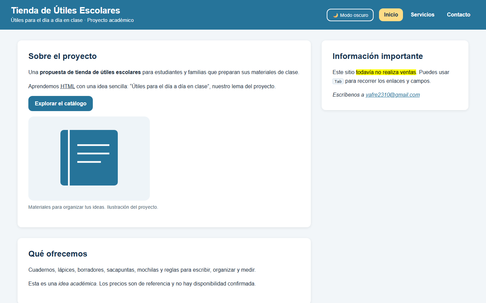
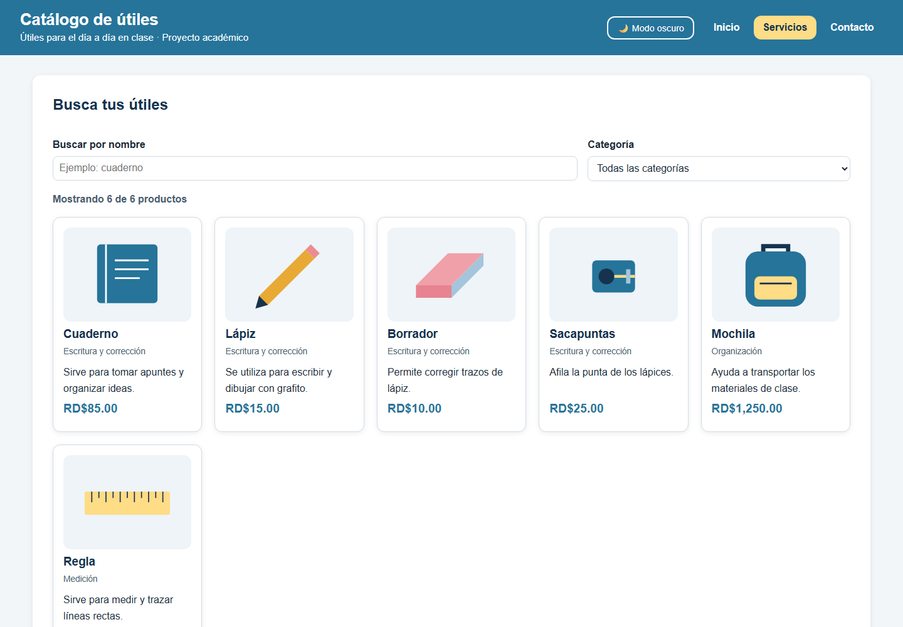
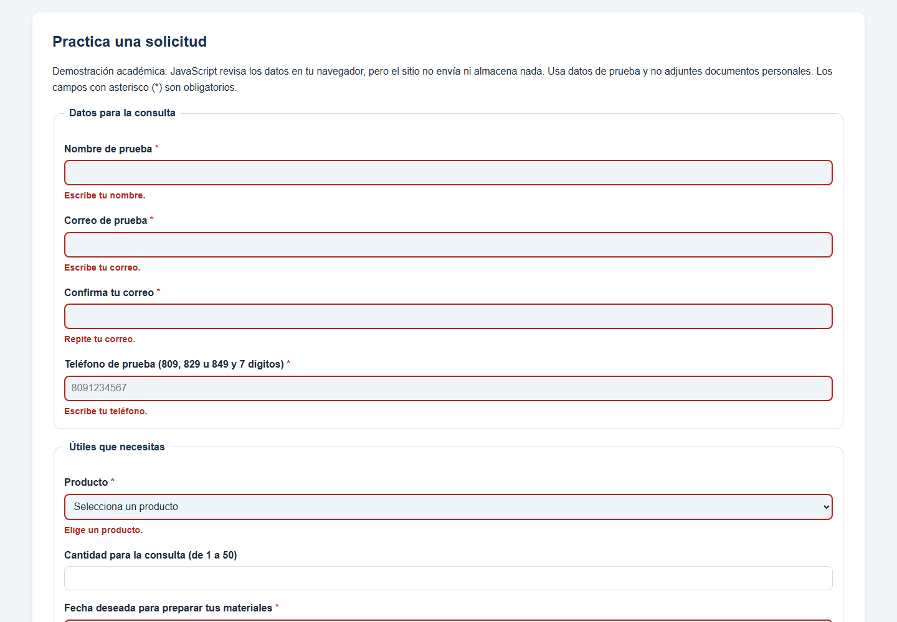
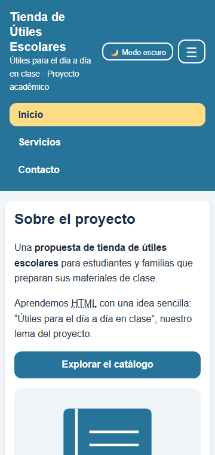
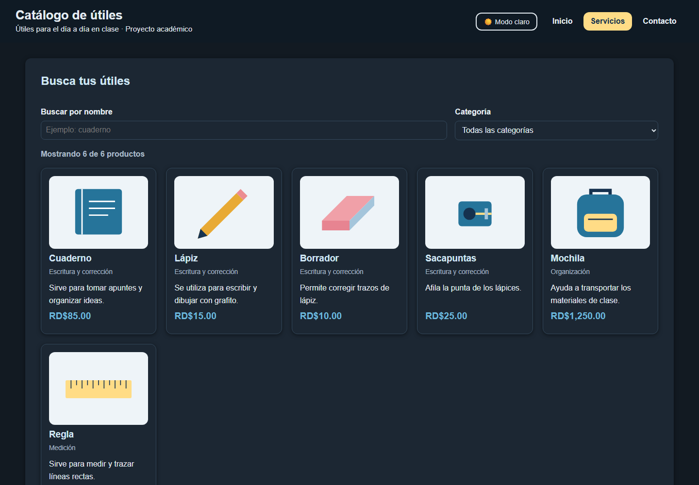

# Tienda de Útiles Escolares

Proyecto académico de la asignatura **ISW-311 Tecnologías de Internet I**. Es el sitio de una tienda de útiles escolares con tres páginas: una portada, un catálogo con buscador y un formulario de contacto que se valida con JavaScript. No realiza ventas y no envía ni guarda los datos del formulario. Los precios son de referencia.

El sitio usa solo **HTML, CSS y JavaScript puros**, sin frameworks ni librerías. No hay que instalar ni compilar nada: basta con abrir `index.html` en el navegador.

## Enlaces

- **Sitio publicado:** pendiente. Cuando se active GitHub Pages, la dirección debería ser `https://yadfreidel.github.io/TIENDA_UTILES/`.
- **Repositorio:** https://github.com/Yadfreidel/TIENDA_UTILES

## Autora

Yadfreidel Victoria Lugo · Matrícula 2023-4137 · [yafre2310@gmail.com](mailto:yafre2310@gmail.com)

## Estructura de archivos

```
TIENDA_UTILES/
├── index.html        Portada
├── servicios.html    Catálogo dinámico, listas, tabla y guía en iframe
├── contacto.html     Datos de contacto y formulario con validación
├── guia.html         Guía corta que se muestra dentro del iframe
├── catalogo.txt      Catálogo en texto para descargar
├── css/estilos.css   Única hoja de estilos
├── js/app.js         Único script (funciona en todas las páginas)
├── imagenes/         Ilustraciones SVG de los productos
└── docs/capturas/    Capturas de pantalla para este README
```

## Capturas

| Portada en escritorio | Catálogo en escritorio |
| --- | --- |
|  |  |

| Formulario con errores | Móvil (360 px) con el menú abierto | Modo oscuro |
| --- | --- | --- |
|  |  |  |

## Las 9 familias de etiquetas HTML

| Familia | Página y sección | Etiquetas usadas | ¿Por qué esa etiqueta? |
| --- | --- | --- | --- |
| Cimientos | Las tres páginas, estructura inicial | DOCTYPE, `html`, `head`, `meta`, `title`, `link`, `script`, `body` | Indican el idioma, el título y la descripción, y enlazan la hoja de estilos y el script (con `defer`). |
| Encabezados y párrafos | Todas las páginas | `h1`, `h2`, `h3`, `p` | Un solo `h1` por página y secciones con `h2` y `h3`, sin saltos de nivel. |
| Texto, citas y código | Inicio y pie de página | `strong`, `em`, `mark`, `abbr`, `small`, `q`, `code`, `kbd`, `blockquote`, `cite` | Destacan ideas, explican una sigla, marcan una tecla y separan una cita de mi propio texto. Son 9 etiquetas. |
| Listas | Catálogo | `ul` con sublista dentro de un `li`, `ol type="a"`, `li`, `dl`, `dt`, `dd` | Agrupan los productos, ordenan los pasos con letras y definen tres palabras del tema. |
| Enlaces | Menú, inicio y contacto | `a` | Navegan entre páginas. El enlace externo usa `target="_blank"` y `rel="noopener"`. También hay enlaces `mailto:`, `tel:`, uno interno a `#solicitud` y uno con `download`. |
| Imágenes y multimedia | Inicio y catálogo | `img`, `figure`, `figcaption`, `iframe` | Muestran los útiles con texto alternativo y una explicación, y la guía dentro de un marco con `title`. **Pendiente:** audio o video con `controls` y `source`. |
| Tablas | Catálogo, usos de los productos | `table`, `caption`, `thead`, `tbody`, `tfoot`, `tr`, `th`, `td` | Relacionan productos, usos, precios y áreas. `scope` identifica los encabezados, `rowspan="4"` reúne cuatro áreas iguales y `colspan="3"` extiende la nota final. |
| Formularios | Contacto, solicitud | `form`, `fieldset`, `legend`, `label`, `input` (9 tipos), `select`, `optgroup`, `option`, `textarea`, `button` | Agrupan los datos en dos `fieldset`. Usan `required`, `minlength`, `min`, `max` y `pattern`, y cada error se muestra en un `span` enlazado con `aria-describedby`. |
| Semántica y div/span | Las tres páginas | `header`, `nav`, `main`, `footer`, `section`, `article`, `aside`, `time`, `details`, `summary`, `address`, `div`, `span` | Las etiquetas semánticas dicen qué función tiene cada parte. `div` agrupa elementos solo para el diseño (portada, filtros, tarjetas, tabla). `span` marca el año y los mensajes de error. |

## CSS (`css/estilos.css`)

| Tema | Cómo se resolvió |
| --- | --- |
| Variables | 22 variables en `:root` (colores, fuente, espacios, radio y sombra) usadas con `var()`. |
| Header y menú | Flexbox con `justify-content`, `align-items` y `gap`. |
| Catálogo | Buscador y categoría en Grid `2fr 1fr`. Tarjetas en Grid con `repeat(auto-fill, minmax(220px, 1fr))`, todas de la misma altura, con imágenes del mismo tamaño (`object-fit: contain`) y el precio al final. |
| Ancho | Contenido de hasta 1400 px, centrado, con 32 px de margen lateral. La sección «Materiales para tus clases» es una galería en Grid con imágenes de 180 px de alto. |
| Portada | Grid de dos columnas (`2fr 1fr`) para `main` y `aside`. El footer queda siempre abajo porque el `body` es una columna flex. |
| Diseño adaptable | Media queries de 768 px (menú hamburguesa y una columna) y 480 px (una tarjeta por fila). No hay scroll horizontal a 360 px. |
| Estados | `:hover`, `:focus-visible`, `:nth-child(even)`, `::after` y 5 `transition`. |
| Modo oscuro | `body.oscuro` solo cambia los valores de las variables. |
| Reglas propias | No se usa `!important` ni ninguna regla con `#id`. |

## Funcionalidades de JavaScript (`js/app.js`)

| Funcionalidad | Página | Evento | Función principal |
| --- | --- | --- | --- |
| Abrir y cerrar el menú hamburguesa | Las tres | `click` | `alternarMenu()` |
| Cambiar entre modo claro y oscuro (se guarda en `localStorage`) | Las tres | `click` | `alternarTema()` |
| Aplicar el tema guardado al abrir la página | Todas, incluida `guia.html` | Carga del script | `localStorage.getItem("tema")` |
| Año automático en el footer | Las tres | Carga del script | `new Date().getFullYear()` |
| Mostrar el botón «volver arriba» | Las tres | `scroll` | `revisarScroll()` |
| Subir al inicio de la página | Las tres | `click` | `volverArriba()` |
| Dibujar las tarjetas de los 6 productos | Servicios | Carga del script | `pintarTarjetas()` |
| Buscar por nombre | Servicios | `input` | `filtrarProductos()` |
| Filtrar por categoría | Servicios | `change` | `filtrarProductos()` |
| Validar el formulario | Contacto | `submit` | `validarFormulario()` |
| Borrar el error cuando se corrige un campo | Contacto | `input` | `limpiarError()` |
| Mostrar el resumen de éxito y vaciar el formulario | Contacto | `submit` (si no hay errores) | `mostrarExito()` |

Reglas propias de la validación: teléfono dominicano (809, 829 u 849 + 7 dígitos), confirmación de correo, fecha que no sea pasada y cantidad entre 1 y 50 si se escribe.

## Pendientes reales

- Agregar un audio o video con `controls` y `source` (familia «Imágenes y multimedia»).
- Activar GitHub Pages y poner aquí el enlace real del sitio.
- Pasar las tres páginas por https://validator.w3.org/ (**Validate by File Upload**) y corregir cualquier error.

## Cómo publicar en GitHub Pages

1. En el repositorio, abre **Settings → Pages**.
2. En **Source** elige **Deploy from a branch**, la rama `master` y la carpeta raíz `/`, y pulsa **Save**.
3. Espera a que termine el despliegue y copia la dirección que muestre GitHub.
4. Abre Inicio, Servicios y Contacto desde esa dirección y revisa imágenes, guía, descarga, formulario y modo oscuro, también en el celular.

Referencia: [documentación oficial de GitHub Pages](https://docs.github.com/en/pages/getting-started-with-github-pages/configuring-a-publishing-source-for-your-github-pages-site).

## Preguntas para practicar

- HTML: ¿qué diferencia hay entre `section` y `article`? ¿Para qué sirve `datetime` en `time`? ¿Qué diferencia hay entre `rowspan` y `colspan`?
- CSS: ¿por qué el modo oscuro solo cambia variables? ¿Qué hace `repeat(auto-fit, minmax(220px, 1fr))`? ¿Por qué las media queries van al final?
- JavaScript: ¿qué hace `classList.toggle()`? ¿Para qué sirve `event.preventDefault()`? ¿Qué diferencia hay entre `forEach` y `filter`? ¿Por qué cada parte va dentro de un `if`?
