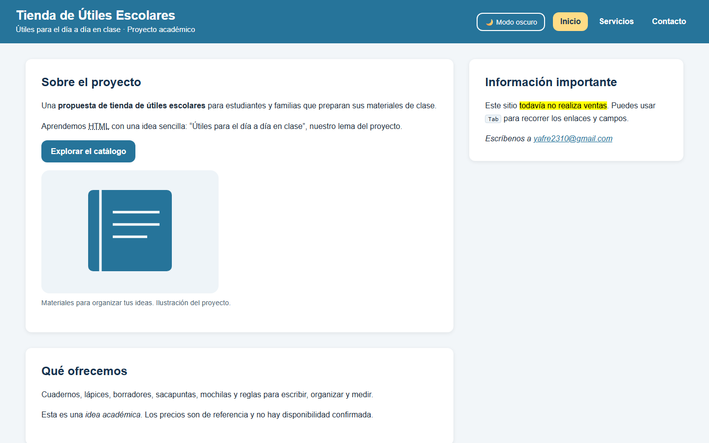
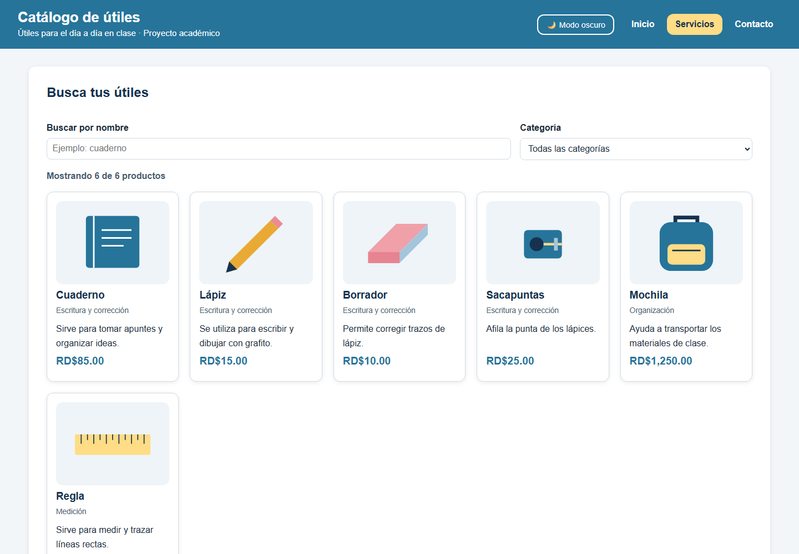
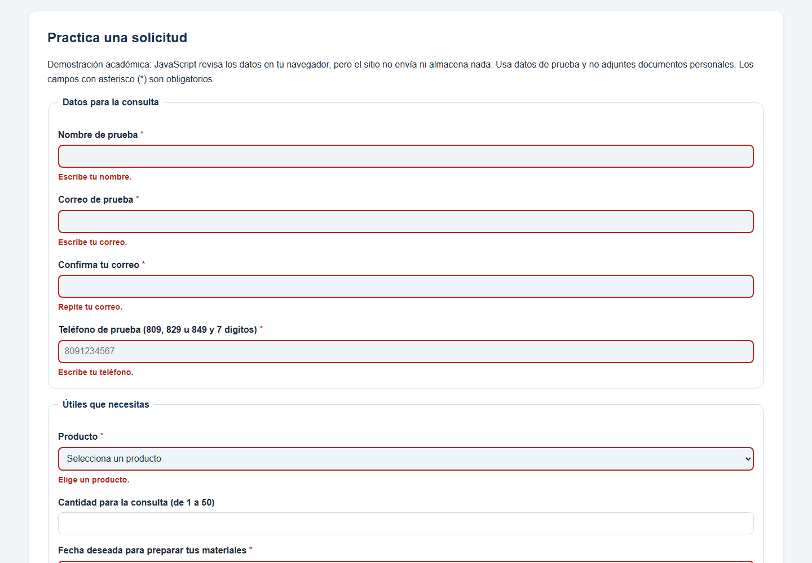
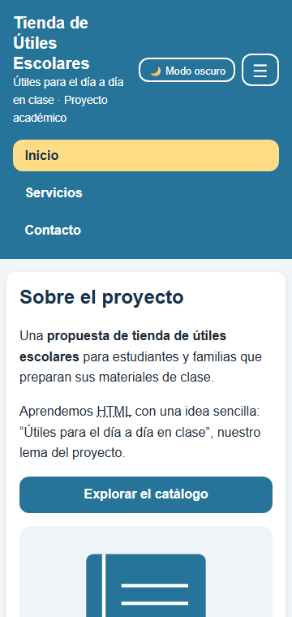
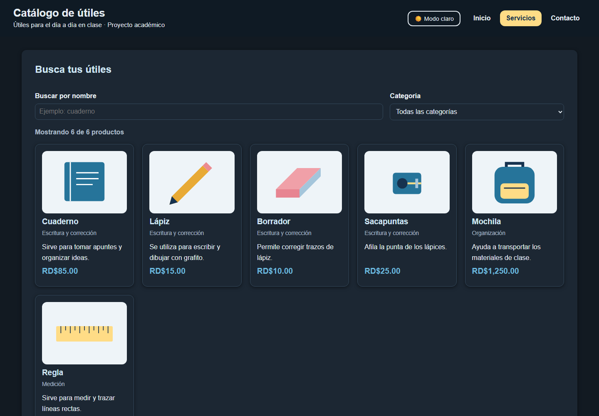

<div class="portada-doc" markdown="1">

# Tienda de Útiles Escolares

## Documentación técnica del proyecto

**Tarea:** Sitio de tu proyecto: HTML5 + CSS + JavaScript

**Asignatura:** ISW-311 Tecnologías de Internet I

**Autora:** Yadfreidel Victoria Lugo

**Matrícula:** 2023-4137

**Fecha:** 10 de noviembre de 2026

**Sitio publicado:** <https://yadfreidel.github.io/TIENDA_UTILES/>

**Repositorio:** <https://github.com/Yadfreidel/TIENDA_UTILES>

</div>

## 1. Descripción del dominio y objetivo del sitio

El proyecto es una tienda de útiles escolares. Muestra seis productos: cuaderno, lápiz, borrador, sacapuntas, mochila y regla, cada uno con un precio de referencia en pesos dominicanos. El público son estudiantes y sus familias que preparan los materiales de clase.

Es un proyecto académico. El sitio no vende nada, y el formulario de contacto no envía ni guarda datos: solo los revisa en el navegador.

<!-- REVISAR -->
Mi objetivo fue hacer un sitio sencillo de tres páginas donde se vea todo lo que aprendí. En el HTML usé las etiquetas correctas, en el CSS di el diseño adaptable y el modo oscuro, y con JavaScript hice el catálogo con buscador y la validación del formulario.

## 2. Estructura de archivos y separación de capas

```
TIENDA_UTILES/
├── index.html        Portada: presentación, novedad y pregunta frecuente
├── servicios.html    Catálogo dinámico, galería, listas, tabla y guía en iframe
├── contacto.html     Datos de contacto y formulario con validación
├── guia.html         Guía corta que se muestra dentro del iframe
├── catalogo.txt      Catálogo en texto para descargar
├── css/estilos.css   Única hoja de estilos (12 secciones)
├── js/app.js         Único script (6 partes)
├── imagenes/         6 ilustraciones SVG de los productos
└── docs/             Esta documentación y las capturas
```

Cada lenguaje está en su propio archivo:

| Capa | Archivo | Qué hace | Cómo se conecta |
| --- | --- | --- | --- |
| Estructura | `*.html` | El contenido y su significado | — |
| Diseño | `css/estilos.css` | Colores, tamaños y posición | `<link rel="stylesheet" href="css/estilos.css">` en el `head` |
| Comportamiento | `js/app.js` | Menú, tema, catálogo y validación | `<script src="js/app.js" defer></script>` en el `head` |

En el HTML no hay ningún atributo `style="..."` ni `onclick="..."`. Todo el diseño está en el CSS y todos los eventos están en el JS.

<!-- REVISAR -->
Separé las tres capas para poder cambiar una sin tocar las otras. Por ejemplo, puedo cambiar todos los colores en el CSS sin abrir el HTML.

## 3. Nivel 1 · Estructura (HTML)

### 3.1 Decisiones semánticas por página

Las tres páginas comparten el mismo `header` (título, botón de tema, botón hamburguesa y `nav` con tres enlaces) y el mismo `footer`. El enlace de la página actual lleva `aria-current="page"`.

| Página | Estructura del contenido |
| --- | --- |
| `index.html` | Un `div.portada` reúne el `main` y el `aside` en dos columnas. El `main` tiene dos `section` («Sobre el proyecto» y «Qué ofrecemos»), un `article` («Novedad del proyecto») y un `details`. El `aside` tiene la información importante y un `address`. |
| `servicios.html` | Cinco `section`: buscador y tarjetas, galería de materiales, listas, tabla y guía en `iframe`. |
| `contacto.html` | Dos `section`: datos de contacto (`address`) y el formulario (`id="solicitud"`). |

<!-- REVISAR -->
- Usé `section` para los bloques que tienen su propio título dentro de la página.
- Usé `article` para la novedad y para cada tarjeta, porque se pueden leer solos.
- El `aside` es información que acompaña la portada pero no es lo principal.
- Hay un solo `h1` por página y nunca salto de `h2` a `h4`.

Etiquetas de texto que se usan, con su ubicación:

| Etiqueta | Dónde |
| --- | --- |
| `strong`, `abbr`, `q` | Inicio, «Sobre el proyecto» |
| `em` | Inicio, «Qué ofrecemos» |
| `time`, `code`, `blockquote`, `cite` | Inicio, «Novedad del proyecto» |
| `mark`, `kbd`, `address` | Inicio, `aside` |
| `details`, `summary` | Inicio, al final del `main` |
| `address` | Contacto, «Acerca del contacto» |
| `small` | Footer de las tres páginas |

### 3.2 La tabla

La tabla está en Servicios, en «Usos de los productos», dentro de un `div.tabla-contenedor` para que en el celular haga scroll sin romper la página.

```html
<caption>Seis útiles, sus funciones y precios de referencia</caption>
...
<th scope="row">Cuadernos</th>
<td>Tomar apuntes</td>
<td>85</td>
<td rowspan="4">Escritura y corrección</td>
...
<td colspan="3">Precios de referencia para el proyecto. No se realizan ventas.</td>
```

- `caption` es el título de la tabla.
- `thead`, `tbody` y `tfoot` separan los encabezados, los datos y la nota.
- `scope="col"` y `scope="row"` dicen si un `th` encabeza una columna o una fila.
- `rowspan="4"` une las celdas de los cuatro productos de «Escritura y corrección».
- `colspan="3"` hace que la nota ocupe tres columnas.

### 3.3 El formulario

El formulario está en Contacto y tiene dos `fieldset` con su `legend`: «Datos para la consulta» y «Útiles que necesitas».

| Campo | Tipo | Atributos de validación |
| --- | --- | --- |
| Nombre | `text` | `required`, `minlength="3"` |
| Correo | `email` | `required` |
| Confirmar correo | `email` | `required` |
| Teléfono | `tel` | `required`, `pattern="(809\|829\|849)[0-9]{7}"` |
| Producto | `select` con 2 `optgroup` | `required` |
| Cantidad | `number` | `min="1"`, `max="50"` |
| Fecha | `date` | `required` |
| Hora | `time` | — |
| Lista escolar | `file` | — |
| Tipo de consulta | 2 `radio` con el mismo `name` | — |
| Mensaje | `textarea` | — |
| Confirmación | `checkbox` | — |

Cada campo validado tiene un `span` de error debajo y los dos están unidos con `aria-describedby`:

```html
<input type="text" id="nombre" name="nombre" required minlength="3"
       aria-describedby="error-nombre">
<span class="error" id="error-nombre"></span>
```

El `form` tiene `novalidate`. Así el navegador no muestra sus globos y quien muestra los errores es JavaScript. Las etiquetas de los campos obligatorios tienen la clase `requerido`, y el CSS les agrega un asterisco.

<!-- REVISAR -->
Dejé los atributos `required`, `min`, `max` y `pattern` aunque uso `novalidate`, porque documentan las reglas en el HTML. Si JavaScript fallara, las reglas seguirían escritas ahí.

## 4. Nivel 2 · Diseño (CSS)

### 4.1 Variables de `:root`

| Variable | Valor (claro) | Valor (oscuro) | Uso |
| --- | --- | --- | --- |
| `--color-primario` | `#26749a` | `#6cb8dc` | Enlaces, botones, precios, encabezados de tabla |
| `--color-oscuro` | `#16324f` | — | Texto sobre el amarillo (menú activo, `caption`) |
| `--color-acento` | `#ffdc86` | — | Menú activo, `caption`, borde de la cita, contorno de foco |
| `--color-fondo` | `#f2f6f9` | `#121a22` | Fondo de la página |
| `--color-superficie` | `#ffffff` | `#1c2733` | Fondo de las secciones, tarjetas y campos |
| `--color-texto` | `#1d2b3a` | `#e4ecf2` | Texto normal |
| `--color-texto-suave` | `#4a5d70` | `#a9bac8` | `figcaption`, categoría, contador |
| `--color-borde` | `#cfdbe5` | `#34495c` | Bordes de tabla, campos y tarjetas |
| `--color-fila` | `#eef4f8` | `#243241` | Filas pares, cita, `code`, `kbd` |
| `--color-error` | `#b3261e` | `#ff8a80` | Mensajes de error y asterisco |
| `--color-exito` | `#1e7a3c` | `#7ddc95` | Borde del mensaje de éxito |
| `--color-titulos` | `#16324f` | `#cfe6f3` | `h1`, `h2`, `h3`, `legend` |
| `--color-sobre-primario` | `#ffffff` | `#0f1a24` | Texto encima del color primario |
| `--color-encabezado` | `#26749a` | `#0f1a24` | Fondo del header |
| `--color-texto-encabezado` | `#ffffff` | `#e4ecf2` | Texto y bordes del header |
| `--color-pie` | `#16324f` | `#0b1218` | Fondo del footer |
| `--fuente` | `"Poppins", Arial, sans-serif` | — | Fuente de todo el sitio |
| `--espacio` | `1rem` | — | Espacio pequeño |
| `--espacio-grande` | `2rem` | — | Espacio grande |
| `--radio` | `12px` | — | Bordes redondeados |
| `--sombra` | `0 2px 8px rgba(0,0,0,0.08)` | `0 2px 8px rgba(0,0,0,0.5)` | Sombra de las tarjetas |
| `--ancho-maximo` | `1400px` | — | Ancho máximo del contenido |
| `--color-fondo-imagen` | `#eef4f8` | — | Fondo detrás de las ilustraciones |

Son 23 variables. Una raya (—) indica que el modo oscuro no cambia ese valor.

### 4.2 Secciones de la hoja de estilos

1. Variables
2. Base (`box-sizing`, `body`, títulos, imágenes, cita, `code`)
3. Header y menú
4. Layout (`main`, tarjetas blancas, portada, `iframe`)
5. Botones
6. Catálogo: filtros, tarjetas y galería
7. Tabla
8. Formulario
9. Footer y botón «volver arriba»
10. Estados visuales: hover, foco y transiciones
11. Modo oscuro
12. Media queries (van al final para que ganen a las reglas de arriba)

### 4.3 Tipos de selector con ejemplos reales

| Tipo | Ejemplo del proyecto |
| --- | --- |
| Universal | `* { box-sizing: border-box; }` |
| Etiqueta | `body`, `table`, `fieldset` |
| Agrupado | `h1, h2, h3 { ... }` |
| Clase | `.boton`, `.tarjeta`, `.filtros` |
| Descendiente | `.marca h1`, `tbody tr`, `.tarjeta img` |
| Atributo | `.menu a[aria-current="page"]`, `input[type="radio"]` |
| Hermano adyacente | `input[type="checkbox"] + label` |
| Compuesto (dos clases) | `body.oscuro`, `.boton-arriba.visible`, `.menu.abierto` |
| Pseudoclase | `:hover`, `:focus-visible`, `:nth-child(even)`, `:empty` |
| Pseudoelemento | `label.requerido::after { content: " *"; }` |

No hay ninguna regla con `#id` ni ningún `!important`.

### 4.4 Flexbox y Grid

**Flexbox**, para alinear en una sola dirección:

- `body`: columna (`flex-direction: column`) con `min-height: 100vh`. Como `main` tiene `flex: 1`, el footer queda siempre abajo.
- `.encabezado`: título, botones y menú en una fila con `justify-content: space-between`, `align-items: center` y `gap`.
- `.menu` y `.botones-encabezado`: los elementos en fila.
- `.tarjeta`: columna. Con `margin-top: auto`, el precio queda siempre al final de la tarjeta.

**Grid**, para repartir en filas y columnas:

```css
.portada  { grid-template-columns: 2fr 1fr; }   /* main y aside */
.filtros  { grid-template-columns: 2fr 1fr; }   /* buscador y categoría */
.tarjetas { grid-template-columns: repeat(auto-fill, minmax(220px, 1fr)); gap: 20px; }
.galeria  { grid-template-columns: repeat(auto-fill, minmax(220px, 1fr)); gap: 20px; }
```

`repeat(auto-fill, minmax(220px, 1fr))` crea todas las columnas que caben, de 220 px como mínimo. Las imágenes de las tarjetas miden 150 px de alto y las de la galería 180 px. Usan `object-fit: contain` para verse completas sin deformarse.

<!-- REVISAR -->
Usé Flexbox cuando los elementos van en una sola línea y Grid cuando necesito columnas. Elegí `auto-fill` en vez de `auto-fit` para que una sola tarjeta filtrada no se estire a todo el ancho.

### 4.5 Media queries

| Media query | Qué cambia |
| --- | --- |
| `@media (max-width: 768px)` | La portada pasa a una columna (el `aside` baja). Aparece el botón ☰ y el menú se oculta hasta que tiene la clase `.abierto`; al abrirse va en columna. Los filtros quedan uno debajo del otro. Hay menos espacio interior en `main`, secciones y `aside`. |
| `@media (max-width: 480px)` | Título y botón de tema más pequeños. Menos margen lateral. Una sola tarjeta por fila. `.boton` ocupa todo el ancho. Celdas de la tabla más pequeñas. |

### 4.6 Estados visuales

- `:hover` en el menú, los botones del header, `.boton` (sube 2 px) y `.tarjeta` (sube 4 px y la sombra crece).
- `:focus-visible` muestra un contorno grueso al navegar con <kbd>Tab</kbd>: amarillo en enlaces, botones y `summary`, y azul en los campos.
- 5 `transition` hacen los cambios suaves: menú, botones del header, `.boton`, `.tarjeta` y `.boton-arriba`.
- `.invalido` pone un borde rojo al campo con error y `.error` pinta el texto en rojo.
- `.mensaje-exito:empty` oculta la caja de éxito mientras está vacía.

### 4.7 Modo oscuro solo con variables

JavaScript pone la clase `oscuro` en el `body`, y el CSS solo cambia los valores de las variables:

```css
body.oscuro {
    --color-primario: #6cb8dc;
    --color-fondo: #121a22;
    --color-superficie: #1c2733;
    --color-texto: #e4ecf2;
    /* ... 15 variables en total */
}
```

Todas las reglas usan `var(--...)`, así que se actualizan solas. No hizo falta repetir ningún selector.

<!-- REVISAR -->
Así el modo oscuro ocupa un solo bloque. Si quiero cambiar un color oscuro, lo cambio en un único lugar.

## 5. Nivel 3 · Comportamiento (JavaScript)

### 5.1 Organización de `app.js`

El archivo tiene 6 partes numeradas con comentarios:

1. Menú hamburguesa
2. Modo oscuro con `localStorage`
3. Año automático en el footer
4. Botón «volver arriba» (detalle propio)
5. Catálogo dinámico (Servicios)
6. Validación del formulario (Contacto)

Solo se usan `const` y `let`, nunca `var`. Todos los eventos se conectan con `addEventListener` y nunca se usa `alert()`.

### 5.2 Protección por página con `if (elemento)`

Un solo script se carga en todas las páginas. Cada parte busca sus elementos y solo trabaja si existen:

```js
const formulario = document.querySelector("#formulario");
...
if (formulario && mensajeExito) {
    formulario.addEventListener("submit", validarFormulario);
}
```

En `index.html` no hay `#formulario`, así que esa parte no se ejecuta y la consola no muestra errores.

### 5.3 Cada funcionalidad

**Menú hamburguesa.** `alternarMenu()` pone o quita la clase `abierto` y actualiza `aria-expanded` para los lectores de pantalla.

```js
menu.classList.toggle("abierto");
if (menu.classList.contains("abierto")) {
    botonMenu.setAttribute("aria-expanded", "true");
} else {
    botonMenu.setAttribute("aria-expanded", "false");
}
```

**Modo oscuro.** `alternarTema()` cambia la clase del `body` y guarda la elección. Al abrir cualquier página se lee lo guardado:

```js
const temaGuardado = localStorage.getItem("tema");
if (temaGuardado === "oscuro") {
    document.body.classList.add("oscuro");
}
```

`actualizarTextoBotonTema()` cambia el texto del botón entre «🌙 Modo oscuro» y «☀️ Modo claro».

**Año automático.**

```js
spanAnio.textContent = new Date().getFullYear();
```

**Detalle propio: volver arriba.** `revisarScroll()` muestra el botón cuando la página bajó más de 300 px, y `volverArriba()` sube suavemente:

```js
window.scrollTo({ top: 0, behavior: "smooth" });
```

<!-- REVISAR -->
Elegí este detalle porque Servicios es una página larga y así se puede volver al menú con un clic.

**Catálogo.** `pintarTarjetas(lista)` recorre la lista con `forEach` y arma un `article.tarjeta` por producto con una plantilla:

```js
lista.forEach(function (producto) {
    html += `
        <article class="tarjeta">
            
            <h3>${producto.nombre}</h3>
            ...
            <p class="precio">${formatearPrecio(producto.precio)}</p>
        </article>
    `;
});
```

**Formato de moneda.** `formatearPrecio()` usa el formato dominicano. Por ejemplo, `1250` se muestra como RD$1,250.00:

```js
return precio.toLocaleString("es-DO", { style: "currency", currency: "DOP" });
```

### 5.4 El arreglo de objetos y el flujo de filtrado

Los productos están en un arreglo de 6 objetos con los mismos datos que la tabla y `catalogo.txt`:

```js
const productos = [
    {
        nombre: "Cuaderno",
        categoria: "Escritura y corrección",
        precio: 85,
        descripcion: "Sirve para tomar apuntes y organizar ideas.",
        imagen: "imagenes/cuadernos.svg"
    },
    ...
];
```

El filtrado sigue estos pasos:

1. La persona escribe en `#buscador` (evento `input`) o cambia `#filtro-categoria` (evento `change`).
2. `filtrarProductos()` lee el texto con `trim()` y `toLowerCase()`, y lee la categoría elegida.
3. `productos.filter(...)` crea una lista nueva solo con los productos que cumplen las dos condiciones: el nombre contiene el texto y la categoría coincide (o es «todas»).
4. `pintarTarjetas(productosFiltrados)` dibuja solo esos productos.
5. El contador muestra «Mostrando X de Y productos».
6. Si no quedó ninguno, se quita `hidden` al mensaje `#sin-resultados`.

Al abrir la página se llama una vez a `filtrarProductos()`, así se ven los 6 productos.

### 5.5 Validación del formulario y reglas propias

`validarFormulario(event)` se ejecuta en el `submit`. Primero llama a `event.preventDefault()` para que la página no se recargue. Después revisa cada regla:

| N.º | Regla | Mensaje de error |
| --- | --- | --- |
| 1 | Nombre obligatorio, de 3 letras o más | «El nombre debe tener al menos 3 letras.» |
| 2 | Correo con formato `/^[^\s@]+@[^\s@]+\.[^\s@]+$/` | «El correo no es válido. Ejemplo: nombre@gmail.com» |
| 3 | **Propia:** la confirmación es igual al correo | «Los correos no coinciden.» |
| 4 | **Propia:** teléfono `/^(809\|829\|849)\d{7}$/` | «Usa 10 dígitos sin guiones que empiecen por 809, 829 u 849...» |
| 5 | Elegir un producto | «Elige un producto.» |
| 6 | **Propia:** cantidad de 1 a 50 si se escribe | «La cantidad debe estar entre 1 y 50.» |
| 7 | **Propia:** la fecha no puede ser pasada | «La fecha no puede estar en el pasado.» |

`mostrarError(campo, mensaje)` escribe en `#error-` + el id del campo y le pone la clase `invalido`. `limpiarError(campo)` lo deshace, y también se ejecuta con el evento `input` cuando la persona corrige el campo. Si hay errores, el cursor va al primer campo inválido con `focus()`. Si no hay ninguno, `mostrarExito()` muestra un resumen y `formulario.reset()` vacía el formulario. El resumen se arma con `createElement` y `textContent`, no con `innerHTML`, para que lo que escribe la persona nunca se lea como código.

La fecha se compara así:

```js
const hoy = new Date();
hoy.setHours(0, 0, 0, 0);
const fechaElegida = new Date(textoFecha + "T00:00:00");
return fechaElegida < hoy;
```

**¿Por qué HTML solo no cubre estas reglas?**

<!-- REVISAR -->
- HTML no puede comparar dos campos entre sí, así que no sabe si la confirmación es igual al correo.
- Con `min` en un `date` habría que escribir una fecha fija, y mañana ya sería vieja. JavaScript calcula la fecha de hoy cada vez.
- El `pattern` del teléfono existe en el HTML, pero con `novalidate` es JavaScript quien muestra un mensaje claro en español debajo del campo.
- Los mensajes del navegador cambian según el navegador y el idioma. Con JavaScript yo escribo mis propios mensajes.

## 6. Pruebas

| Prueba | Herramienta | Resultado |
| --- | --- | --- |
| HTML de `index.html` | validator.w3.org (Nu Html Checker), sitio publicado | 0 errores, 0 advertencias |
| HTML de `servicios.html` | validator.w3.org | 0 errores, 0 advertencias |
| HTML de `contacto.html` | validator.w3.org | 0 errores, 0 advertencias |
| HTML de `guia.html` | validator.w3.org | 0 errores, 0 advertencias |
| CSS `estilos.css` | jigsaw.w3.org (CSS nivel 3) | Válido: 0 errores. 8 avisos que solo dicen que las variables CSS no se revisan de forma estática |
| Consola | Microsoft Edge, las tres páginas publicadas | Sin errores del sitio |
| 360 px | Edge, página dentro de un marco de 360 px | Sin scroll horizontal. Solo la tabla hace scroll dentro de su propio contenedor |
| Catálogo | Edge | «cua» muestra 1 de 6, «Medición» muestra 1 de 6 y «xyz» muestra el mensaje sin resultados |
| Formulario | Edge | Vacío: 6 errores. Correos distintos, teléfono 7001234567, cantidad 60 y fecha de ayer muestran su error. Datos correctos muestran el resumen |
| Modo oscuro | Edge | Se mantiene al cambiar de página y en la guía del `iframe` |

Las validaciones de W3C se hicieron el 10 de noviembre de 2026.

### Capturas











## 7. Historial de commits

Commits de la rama `master` (`git log`), del más reciente al más antiguo:

| Commit | Fecha | Mensaje |
| --- | --- | --- |
| `fff1f0d` | 2026-11-10 | Amplía el diseño a 1400px, agrega atributos de validación, galería de materiales y README final con capturas |
| `cd20e03` | 2026-11-10 | Agrega JavaScript: menú, modo oscuro, año, volver arriba, catálogo dinámico y validación del formulario |
| `2553364` | 2026-11-10 | Agrega estilos con variables, Flexbox, Grid, media queries, estados visuales y modo oscuro |
| `c9214e7` | 2026-11-10 | Prepara el HTML para CSS y JS: botones de menú y tema, contenedores del catálogo, spans de error y precios de referencia |
| `e73b8ee` | 2026-11-03 | Quita el enlace a MDN de la pagina de contacto |
| `3ea1cd6` | 2026-11-03 | Elimina revision y multimedia y retira referencias al audio |
| `241e861` | 2026-11-03 | Elimina el script de comprobacion del navegador |
| `4c18295` | 2026-11-03 | Elimina reportes de validacion y script de verificacion |
| `16893da` | 2026-11-03 | Deja las paginas solo en HTML y quita validaciones del formulario |
| `a8af3dd` | 2026-11-03 | Simplifica el sitio para la rubrica HTML5 y completa el audio local |
| `b9dac5e` | 2026-11-03 | Agrega correo y telefono confirmados con enlaces de contacto |
| `3a12b89` | 2026-11-03 | Documenta requisitos y publicacion y verifica el sitio con W3C y navegador |
| `3585674` | 2026-11-03 | Crea formulario académico con validación nativa y descarga real* |
| `b59f12b` | 2026-11-03 | Agrega catálogo con tarjetas listas tabla y guía incrustada* |
| `242404e` | 2026-11-03 | Mejora portada con estilos compartidos e ilustraciones locales |
| `db0bc43` | 2026-11-03 | Conserva la portada inicial de la tarea |

\* En git las tildes de estos dos mensajes quedaron guardadas como «?» por un problema de codificación. Aquí se muestran corregidas.

## 8. Conclusiones

<!-- REVISAR -->
- Aprendí a separar el contenido (HTML), el diseño (CSS) y el comportamiento (JavaScript) en archivos distintos.
- Las etiquetas semánticas hacen que el código se entienda mejor y que el sitio sea más accesible.
- Con variables en `:root`, el modo oscuro fue muy fácil: solo cambié valores en un bloque.
- Flexbox y Grid me permitieron hacer un diseño que se adapta al celular sin usar frameworks.
- Con un arreglo de objetos, `filter` y `forEach`, el catálogo se arma solo y el buscador filtra al instante.
- JavaScript me dejó validar reglas que HTML no puede, como comparar dos correos o revisar que la fecha no sea pasada.
- Lo que me falta mejorar es agregar un audio o video, y que el buscador encuentre palabras escritas sin tilde.
